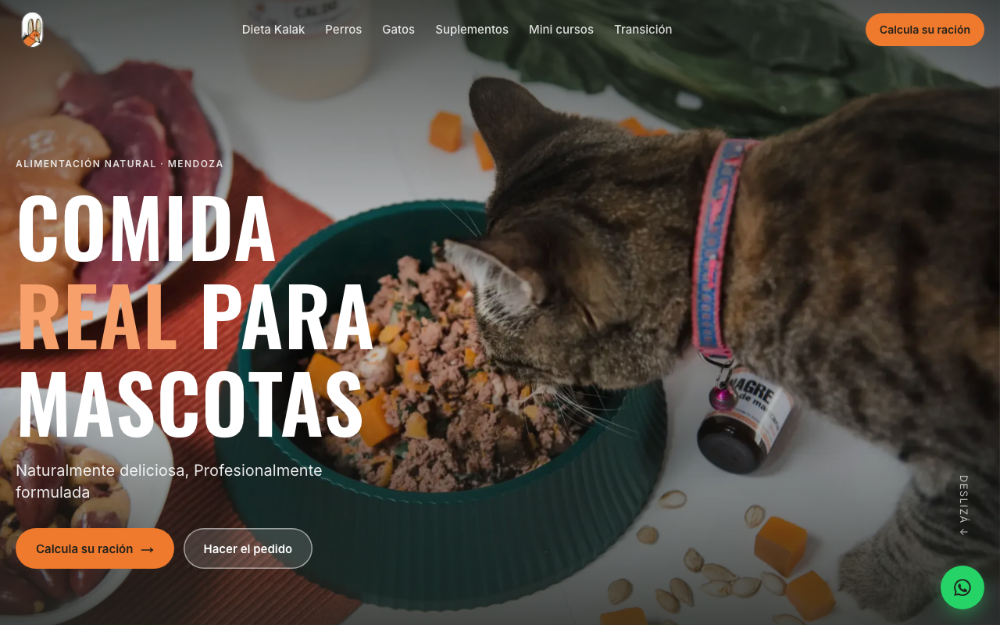

# Kalak

Sitio web de Kalak, marca de alimentación natural para perros y gatos. [Ver demo](https://kalak-v2.vercel.app)



## Funcionalidades

- Información sobre la dieta Kalak, ingredientes y transición alimentaria.
- Secciones de alimentación para perros y gatos.
- Catálogo informativo de suplementos y mini cursos.
- Asistente para calcular raciones según la información de cada mascota.
- Resumen del pedido generado para compartir por WhatsApp.
- Formulario para realizar pedidos y página de contacto.

## Stack

Next.js 16, React 19, TypeScript, Tailwind CSS 4 y Vitest.

## Cómo correrlo en local

Requiere Node.js y pnpm.

```bash
pnpm install
pnpm dev
```

Scripts disponibles: `pnpm lint`, `pnpm test`, `pnpm typecheck`, `pnpm build`.

## Estructura

- `src/app/`: páginas y rutas de la aplicación.
- `src/components/`: componentes de interfaz y layout.
- `src/features/`: lógica de raciones, asistente y pedidos.
- `src/content/`: contenido del sitio.
- `src/config/`: configuración, precios y razas.
- `docs/`: documentación y recursos visuales.
